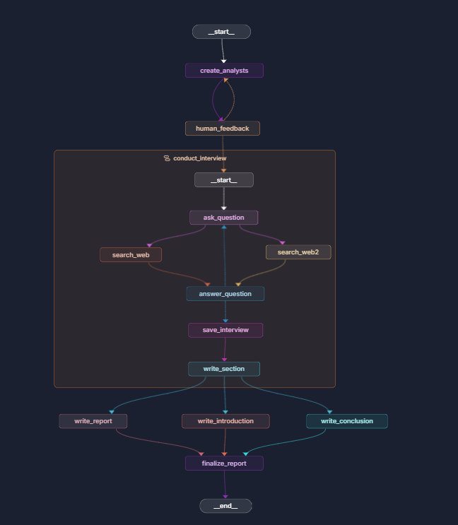

# Agentic Research Agent

An agentic research workflow that turns a topic into a structured, source-backed report. It breaks a broad subject into analyst perspectives, gathers web sources, and synthesizes the findings into an introduction, report, and conclusion. A human feedback checkpoint lets you approve or revise the proposed analysts before research begins.

## Graph



## How it works

1. Generate analyst personas for the requested topic.
2. Pause for human approval or feedback. Feedback regenerates the analysts; approval continues the workflow.
3. Run an interview for each analyst. For each question, two parallel Tavily searches gather sources, and the model answers using that context. Interviews run for two answer turns.
4. Write a research section for each analyst, then create the report, introduction, and conclusion in parallel.
5. Combine the results into `final_report`, preserving the report's source list.

## Tech stack

- Python 3.12+
- LangGraph for graph orchestration, state, parallel work, and human-in-the-loop pauses
- LangChain and Ollama for local language models
- Tavily for web search
- Pydantic for structured analyst and search-query outputs

## Requirements

- [Ollama](https://ollama.com/download) installed and running locally
- A Tavily API key
- [uv](https://docs.astral.sh/uv/getting-started/installation/) for dependency management

Install the two models used by the graph:

```bash
ollama pull gemma4:e4b
ollama pull llama3.1:latest
```

The application uses `gemma4:e4b` for analyst generation, interviews, and report synthesis, and `llama3.1:latest` to write analyst research sections.

## Setup and run

From the project directory:

```bash
uv sync
```

Create a `.env` file in the project root containing your Tavily key:

```env
TAVILY_API_KEY=your_tavily_api_key
```

Start the LangGraph development server:

```bash
langgraph dev
```

The graphs are registered in `langgraph.json`. Run `final_graph` with `topic` and `max_analysts` as input. The graph pauses for analyst feedback; approve to continue or provide feedback to regenerate the analysts. The final output is returned in `final_report`.